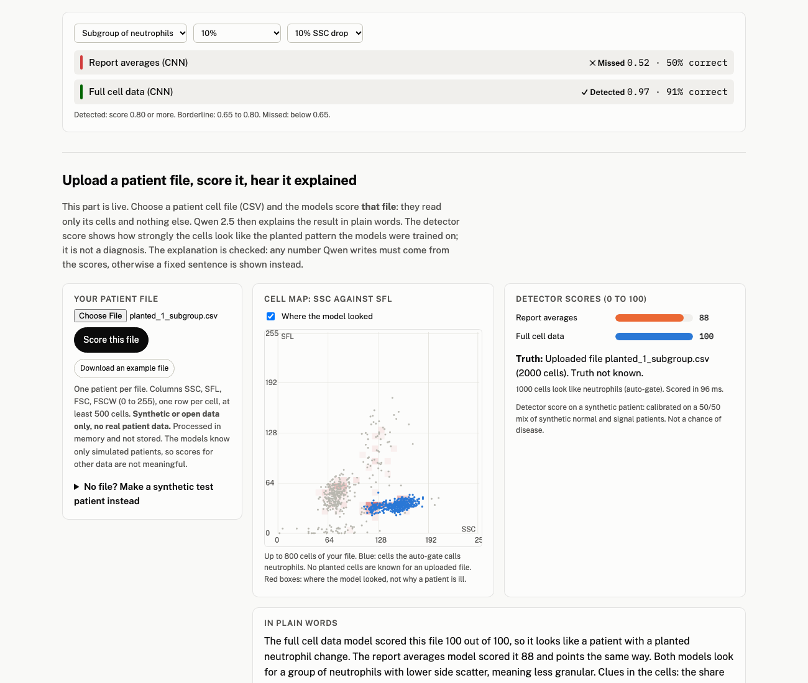
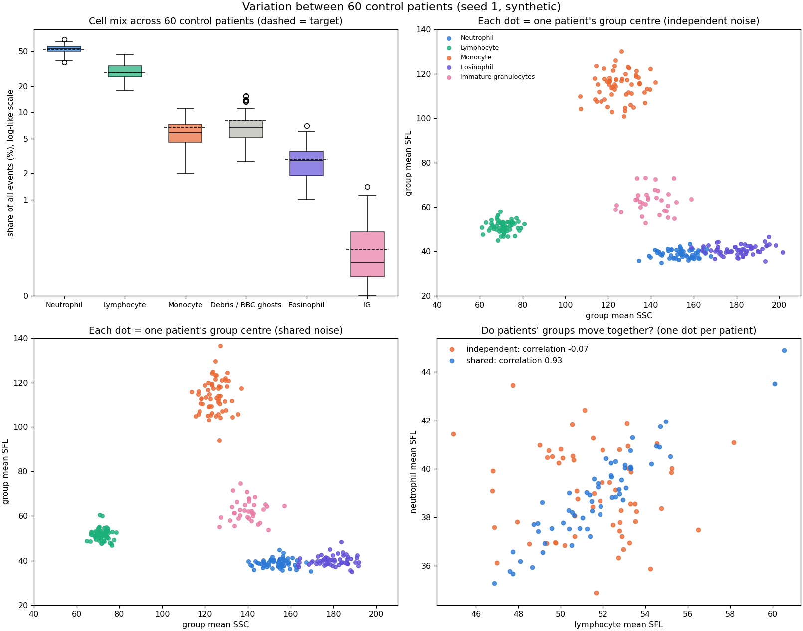
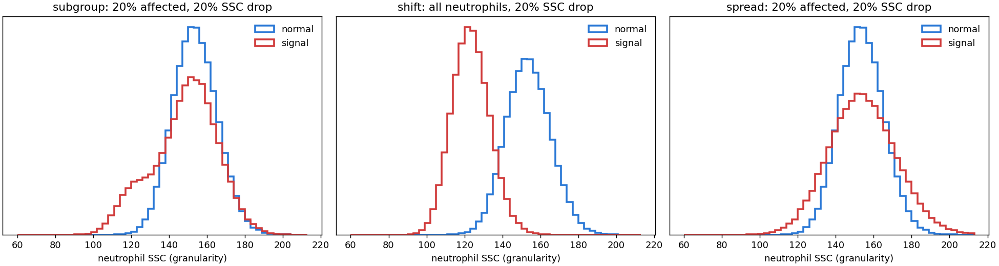
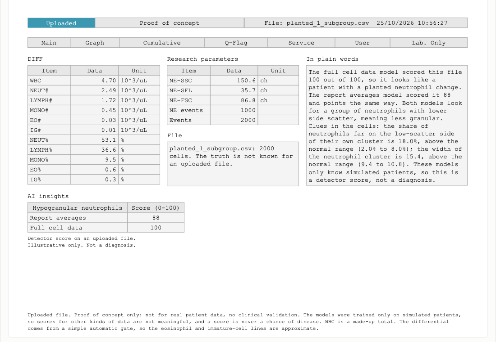

# CellBench: how small a blood-cell change can an AI still see?

*Leeds AI Society "AI in Healthcare" hackathon, 24 to 25 October 2026. **All data is synthetic. No real patient data was used. This is a research prototype, not a diagnostic tool.***



## The question
Haematology analysers such as the Sysmex XN record several measurements for **every single blood cell** (laser scatter and fluorescence). The report a clinician sees keeps only averages and counts. If a disease changes just a small group of cells, the averages can hide it.

1. Can an ML model find single-cell signatures that the averaged report does not show?
2. How small can the change get before each kind of model stops finding it? (a "detection limit")
3. Can a **synthetic data generator** answer this without touching real patient data, avoiding ethics and GDPR problems, so detection limits can be tested before real data is requested?

## What we did
1. **Reference data.** We used a public data set of body fluids run on a Sysmex XN-1000 analyser (Ai et al. 2018, *PLOS ONE*, [doi:10.1371/journal.pone.0190886](https://doi.org/10.1371/journal.pone.0190886), CC BY) to learn the structure of the files and where the cell populations sit.
2. **Synthetic blood.** From those positions we generate blood-like patients (about 2,000 cells each) with six cell groups (neutrophils, lymphocytes, monocytes, eosinophils, immature granulocytes, debris). Every patient gets its own cell mix and noise, shared or independent across cell groups, so patients differ from each other like real ones do (figure below).
3. **Planted signal.** For the "disease" patients we plant an MDS-like pattern, reported to lower the side scatter of some neutrophils (hypogranulation), with a linked smaller drop in fluorescence and forward scatter. Strength varies in two ways: the **share of neutrophils changed** (2, 5, 10, 20%) and the **size of the side-scatter drop** (5, 10, 20%). We also plant two other kinds: the neutrophil cluster only **widens**, and **every** neutrophil shifts. A cohort is 300 normal and 300 changed patients; the main sweep used 5 random seeds and both noise types (180 cohorts per model).
4. **Two views of the same patients, the same type of model.**
   - **Report averages:** what a routine report keeps, a 6 by 5 grid of group averages and shares.
   - **Full cell data:** every cell, as three 32 by 32 count maps (SSC-SFL, SSC-FSC, FSC-SFL), with no group labels.
   - We trained a **CNN** on each view, and repeated with a simpler **MLP** on each view. Patients are split by patient, never by cell, and models are tested on patients they never saw. Training ran on Kaggle (T4 GPU for the CNNs).
5. **Detection limit** (defined before the sweep): the smallest tested share of changed neutrophils whose mean AUROC is at least 0.80 and stays there for every larger share.

|  |  |
|---|---|
| Normal synthetic patients differ from each other, as real ones do. | The three planted changes: a subgroup, a wider cluster, a full shift. |

## Results (synthetic data, 5 seeds, shared noise; AUROC, 0.5 = coin flip, 1.0 = perfect)

| Planted change | CNN: report averages | CNN: **full cell data** | MLP: report averages | MLP: full cell data |
|---|---|---|---|---|
| 10% of neutrophils, 10% side-scatter drop | 0.52 | **0.97** | 0.52 | 0.67 |
| 20% of neutrophils, 10% drop | 0.61 | **1.00** | 0.78 | 0.83 |
| Cluster widens (20%), centre does not move | 0.51 | **0.99** | 0.52 | 0.75 |
| **Detection limit at a 20% drop** | 10% of neutrophils | **2%** | 10% | 5% |

- With the **same** model, keeping every cell detects a smaller change (2% of neutrophils instead of 10%) and also catches a widened cluster that averages cannot see, because the average does not move.
- When **every** neutrophil shifts, both views see it (score near 1.0). Averages are built for that case; the gain from full cell data is for small subgroups and spread changes.
- A **5% side-scatter drop is not detectable** by any model we tested. It is about the size of normal patient-to-patient variation.
- With no change planted, every model scores about 0.50 (0.43 to 0.57 across 40 cohorts), so nothing leaks the answer.
- Full tables for all five model and view combinations: [RESULTS_FULL_SWEEP.md](RESULTS_FULL_SWEEP.md). Gaps under 0.05 are within seed-to-seed noise.
- The final models used in the demo were trained once on mixed scenarios and tested on 15,600 new synthetic patients: full cell CNN AUROC **0.94**, report averages CNN **0.65**.

Wording we stand behind: full cell data **detects smaller cell changes** in synthetic data. We do **not** claim it detects early disease.

## Live demo (prototype)
Upload one patient's cell file (CSV with columns SSC, SFL, FSC, FSCW, 0 to 255, one row per cell). The page returns:
- two **detector scores** (0 to 100), one per view, and a cell map showing where the model looked;
- a **lab-style result sheet** in the layout of a standard analyser result, downloadable as a PDF (clearly marked synthetic, proof of concept);
- a **one-paragraph plain-language explanation** written by a local LLM (Qwen 2.5), with every number checked against the scores, saying why the file looks planted, normal or hard to call, using clues from the cells compared with normal synthetic patients;
- a separate **chat page** (`/chat`) that answers questions about the project from our own notes and declines medical or unrelated questions.



A detector score says how strongly the cells show the planted pattern. It is **not** a diagnosis and **not** a chance of disease.

### Run it
Needs [Docker Desktop](https://www.docker.com/products/docker-desktop/) and [Ollama](https://ollama.com):
```sh
ollama pull qwen2.5:0.5b      # fallback explanations
ollama pull qwen2.5:3b        # explanations and chat answers
ollama pull nomic-embed-text  # chat note search
./run_demo.sh                 # builds the image the first time, then serves http://localhost:8000
```
Try the files in [`demo_uploads_pick/`](demo_uploads_pick/) (5 normal, 5 planted, with expected scores in its README). More synthetic files can be made with `python cellbench/make_demo_files.py --n 2224 --out demo_uploads`. Stop with `docker stop cellbench-live`.

## Repository map
| Path | What is in it |
|---|---|
| `cellbench/generator.py`, `make_data.py`, `configs/experiment.json`, `data/population_table.csv` | The synthetic data generator and its exact settings |
| `cellbench/features.py`, `gating.py`, `models.py`, `evaluate.py`, `sweep.py`, `final_models.py`, `kaggle/` | The two data views, the models, the experiments, and the Kaggle job builders |
| `cellbench/serve/` | The live demo: FastAPI app, scoring, explanations, chat, lab sheet and PDF |
| `RESULTS_FULL_SWEEP.md`, `data/results_full_sweep_summary.csv`, `data/detection_limits_all.csv`, `data/final/` | Results, detection limits, final metrics, trained weights |
| `DATA_DESIGN.md`, `sample_plan.md`, `data/synthetic/DATA_CARD.md` | How and why the data was designed, sample sizes, data card |
| `tests/` | 110 tests (generator, models, demo server, chat) |
| `Dockerfile`, `run_demo.sh`, `requirements*.txt` | Running the demo |

## Reproduce
```sh
python3 -m venv .venv && .venv/bin/pip install -r requirements-dev.txt
.venv/bin/python -m pytest tests -q
.venv/bin/python cellbench/make_data.py        # rebuilds all synthetic cohorts from the seeds
```
The synthetic data is not stored in this repository; it is rebuilt exactly from the code and seeds. Experiments ran on Kaggle (CPU for the MLPs, T4 GPU for the CNNs); the kernel builders are in `cellbench/kaggle/`.

## Limits to read before using any number
- **All data is synthetic.** Cell positions were measured from four public body-fluid XN files and borrowed for a blood-like mix. The cell mix, noise, change sizes and the linked fluorescence and forward-scatter drop are our assumptions. We model patient-to-patient variation, not differences between machines, days or reagents (batch effects).
- The ruler shows what is **detectable**. It does not show that any real disease produces these changes, and it is not a diagnostic tool. The planted pattern is a modelling choice, not a measured disease trajectory.
- Our fake normal cells leave a key area of the cell map nearly empty, which flatters the full-cell CNN. Real data may be harder.
- The report-average view is a stand-in built from auto-gated simulated cells. Its auto-gate is not bit-for-bit reproducible across machines, so live report scores can differ by about 0.1 from the saved evaluation. The full-cell CNN reproduces exactly.
- The models know only simulated patients. A score for any other kind of data is not meaningful. A cell file with very few neutrophils is flagged "out of range".
- The detector score is calibrated on a 50/50 mix of normal and changed patients, so it is not a probability of disease. Some normal patients will score high and small changes will score low.
- The LLM sentences are generated text on top of the scores. Numbers are checked; wording is not clinical advice.
- Higher cell counts and more compute could improve detection of weak signatures. We have not tested that.

## Why this could matter (and what it would take)
Routine blood tests already produce this per-cell data. If it were retained and linked to clinical outcomes in an integrated digital record, such as the data system envisaged in the NHS 10 Year Health Plan, it would be a very large resource for training and testing detection models, potentially for earlier identification of some conditions. See [Real_World_Applications](Real_World_Applications) for how CellBench could fit the NHS 10 Year Health Plan, how it could be used today with Trusts, and the UK GDPR pathways involved. A synthetic generator lets teams find out what is detectable, and which data to ask for, before any real patient data is used. Moving from here to clinical use would need real analyser data, ethics approval, and clinical validation, none of which this project has.

## AI tools used (disclosure)
Code, analysis and documentation were written with **Claude Code** (Anthropic). Plain-language explanations in the demo are written by **Qwen 2.5** (Alibaba), and chat note search uses **nomic-embed-text**, all run locally through Ollama. Models were trained on Kaggle. Pre-existing work: the public example files and the characterisation repository https://github.com/SOwenLU/sysmex-xn-fcs.

## Credits and citation
- Reference data: Ai T, Tabe Y, Takemura H, Kimura K, Takahashi T, Yang H, Tsuchiya K, Konishi A, Uchihashi K, Horii T, Ohsaka A. *Novel flowcytometry-based approach of malignant cell detection in body fluids using an automated hematology analyzer.* PLOS ONE 2018; 13(2): e0190886 (CC BY).
- **Team (Leeds AI Society hackathon, October 2026):** Pranamya Deshpande ([@Pranamya16](https://github.com/Pranamya16)), Kanishq Gandharv, Samuel Owen, Matthew Romero.
- Real-world applications and regulation notes: [Real_World_Applications](Real_World_Applications).
- Licence: [MIT](LICENSE).
